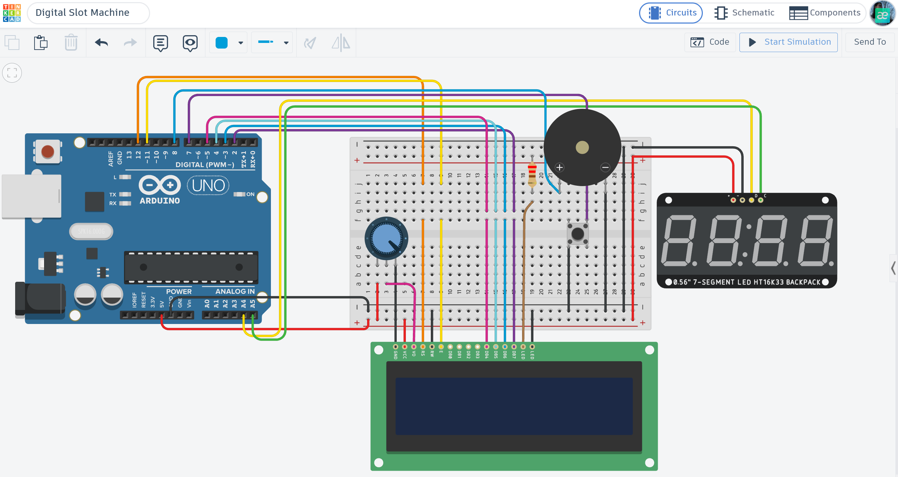

# 🎰 Arduino Digital Slot Machine: Four-Reel Arcade Game

An Arduino-based digital slot machine featuring four spinning reels, an LCD interface, sound effects, and a points-based reward system, designed and simulated in Tinkercad.

## 📌 Project Overview

The Digital Slot Machine is an interactive arcade-style game built with Arduino Uno R3. The player starts the game by pressing a button, activating four spinning reels displayed on a 4-digit 7-segment display.

The system evaluates the final combination, awards points according to the winning pattern, displays the result on a 16x2 LCD, and plays corresponding sound effects.

## ⚙️ How it Works (Game Logic)

1. **Game Initialization:** The Arduino initializes the displays, button, and buzzer. Four random digits are generated and shown on the 7-segment display.
2. **Starting the Game:** The player presses the START button to begin a new round.
3. **Reel Spinning:** The four reels spin sequentially. Each reel gradually slows down before stopping on a randomly selected digit.
4. **Combination Evaluation:** After all four reels stop, the Arduino checks the resulting combination and determines the prize.
5. **Reward System:** Points are awarded according to the winning combination:
   - Four of a Kind — JACKPOT (+1000 points)
   - Three of a Kind — BIG WIN (+250 points)
   - Two Pairs — DOUBLE PAIR (+100 points)
   - One Pair — SMALL WIN (+20 points)
   - All Different — NO WIN (0 points)
6. **Audio and Visual Feedback:** The LCD displays the result, while the buzzer plays a sound corresponding to the outcome.
7. **Score Tracking:** The accumulated score is displayed on the LCD before the game returns to the ready state.

## 🛠 Technical Features

- **Four-Reel Display:** Uses a 4-digit 7-segment display controlled through the HT16K33 I2C interface.
- **Sequential Reel Animation:** Each reel spins and gradually slows down before stopping.
- **Random Number Generation:** Generates random digits from 0 to 9 for each reel.
- **Combination Recognition:** Evaluates four digits and identifies five possible game outcomes.
- **Points-Based Reward System:** Awards different amounts of points depending on the winning combination.
- **LCD Interface:** Displays game status, winning messages, and accumulated score.
- **Sound Effects:** Uses a piezo buzzer to provide audio feedback during spinning and after each result.
- **Button Debouncing:** Uses software debouncing to prevent accidental multiple activations.
- **I2C Communication:** Controls the 4-digit 7-segment display using the HT16K33 controller.

## 🔌 Components Used

- **Arduino Uno R3** — Main microcontroller.
- **4-Digit 7-Segment Display (HT16K33)** — Displays the four game reels.
- **LCD 16x2** — Displays instructions, results, and total score.
- **Potentiometer** — Adjusts LCD contrast.
- **Push Button** — Starts the game.
- **Piezo Buzzer** — Produces sound effects.
- **Resistors and Wires** — Used for circuit connections.

## 📐 Circuit Diagram

*Designed and simulated in Tinkercad.*

## 🚀 Installation & Use

1. **Open the Simulation:** Open the project in Tinkercad Circuits using the interactive simulation link below.
2. **Start the Simulation:** Run the circuit simulation.
3. **Start the Game:** Press the START button to activate the reels.
4. **Watch the Reels:** Wait for all four reels to stop.
5. **Check the Result:** View the winning combination and awarded points on the LCD.
6. **Track Your Score:** The accumulated score is displayed after each round.
7. **Play Again:** Press START to begin another round.

## 📺 Video Demonstration

## 🔗 Interactive Simulation

