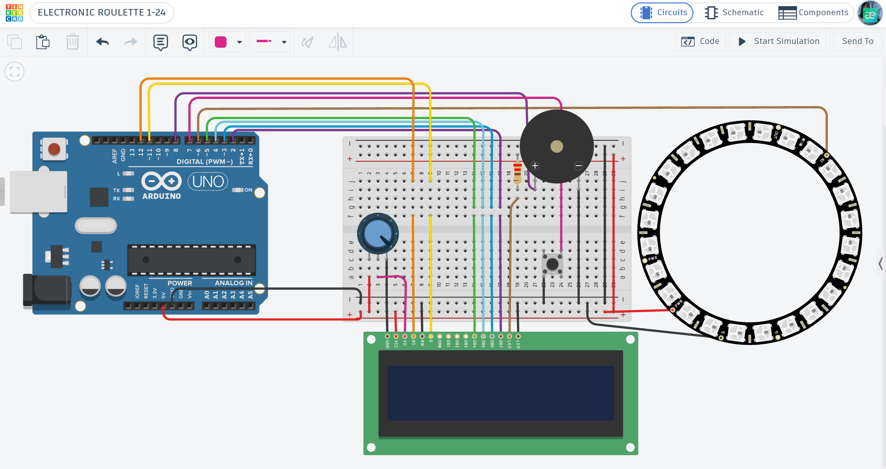

# 🎰 Arduino Electronic Roulette: Random LED Game

An interactive electronic roulette built with Arduino, featuring a 24-LED NeoPixel ring, random bright colors, gradual deceleration, and a winning number display.

## 📌 Project Overview

The "Electronic Roulette" transforms an Arduino into an interactive roulette game. It simulates a spinning roulette wheel using a NeoPixel ring with 24 individually addressable LEDs. The system generates random colors during the spin, gradually slows down, and selects a winning position from 1 to 24. The final result is displayed on an LCD screen, accompanied by LED and sound effects.

## ⚙️ How it Works (Game Logic)
1. **System Initialization:** The LCD displays the welcome message "ELECTRONIC ROULETTE 1-24".
2. **Spin Activation:** Pressing the push button starts the roulette animation.
3. **LED Animation:** A single LED moves around the NeoPixel ring, displaying bright random colors at each step.
4. **Deceleration:** The LED movement gradually slows down, creating a roulette spinning effect.
5. **Winning Number:** The final LED position determines the winning number (1–24).
6. **Visual Feedback:** The winning LED turns green, while the LCD displays the corresponding number.
7. **Sound Effects:** The buzzer plays sounds during the spin and when the roulette stops.

## 🛠 Technical Features
- **Addressable LED Control:** Uses the `Adafruit_NeoPixel.h` library to control 24 individual LEDs.
- **Random Color Generation:** Uses `ColorHSV()` and `gamma32()` to generate bright, saturated colors.
- **Deceleration Algorithm:** Implements an increasing delay (`80 + i * i / 8`) to gradually slow down the LED movement.
- **Random Number Generation:** Selects the winning number based on the final LED position, ensuring synchronization between the LCD and NeoPixel ring.
- **Interactive Interface:** Uses a 16x2 LCD to display the game status and winning number.
- **Sound Feedback:** Uses `tone()` and `noTone()` to generate audio effects.

## 🔌 Components Used
- **Microcontroller:** Arduino Uno R3
- **LED Output:** NeoPixel Ring (24 addressable LEDs)
- **Visual Output:** 16x2 LCD Display
- **Inputs:** Push Button
- **Audio Output:** Piezo Buzzer
- **Control:** Potentiometer (for LCD contrast adjustment)
- **Others:** Breadboard and Jumper Wires.

## 📐 Circuit Diagram

*Designed and simulated in Tinkercad.*

## 🚀 Installation & Use
1. **Get the Code:** Open the [main.ino](./main.ino) file and copy the source code.
2. **Setup:** Paste the code into your Arduino IDE or a new Tinkercad "Code" block.
3. **Hardware:** Connect the NeoPixel Ring, LCD, push button, and buzzer to the pins specified in the `main.ino` header.
4. **Play:** Start the simulation, press the button, watch the roulette spin, and check the winning number displayed on the LCD!

## 📺 Video Demonstration

## 🔗 Interactive Simulation

