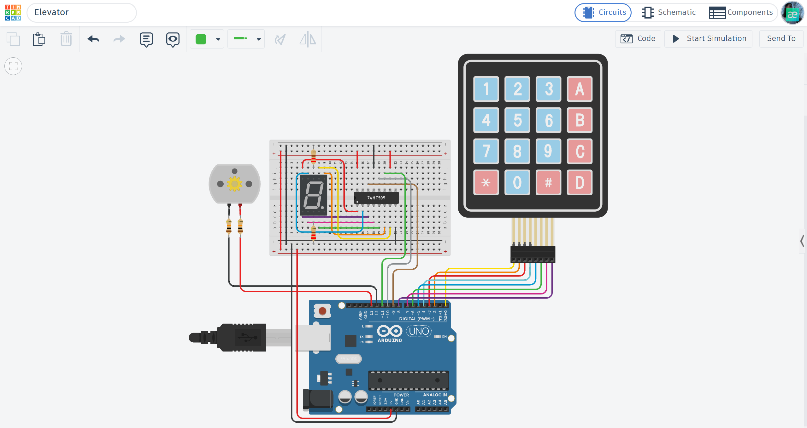

# 🛗 Arduino Elevator: Keypad-Controlled Lift System

A simulated elevator control system designed to select floor numbers using a matrix keypad, display the selected floor, and control motor movement in the corresponding direction.

## 📌 Project Overview
The "Arduino Elevator" transforms an Arduino into a simplified elevator control system. It allows users to select a destination using a 4x4 matrix keypad. A 7-segment display provides visual feedback by showing the selected number, while a DC motor simulates the elevator's movement between floors. The system tracks the previously selected floor and determines the direction and duration of motor operation based on the new selection.

## ⚙️ How it Works (Elevator Logic)
1. **Floor Selection:** The user enters a destination number using the 4x4 keypad.
2. **Visual Feedback:** The selected number is displayed on the 7-segment display.
3. **Floor Comparison:** The system compares the selected number with the previously stored floor number.
4. **Upward Movement:** If the selected number is greater than the current floor, the motor rotates in one direction.
5. **Downward Movement:** If the selected number is lower than the current floor, the motor rotates in the opposite direction.
6. **Arrival:** The motor stops after a time interval proportional to the difference between the selected and current floor numbers.
7. **System Update:** The selected number becomes the new current floor, and the system waits for the next input.

## 🛠 Technical Features
- **Matrix Scanning:** Uses the `Keypad.h` library to detect key presses from a 4x4 matrix keypad using 8 digital pins.
- **7-Segment Display Control:** Uses the `shiftOut()` function to transmit display data through a 74HC595 shift register.
- **Number Representation:** Uses predefined binary arrays (`dataArray` and `letterArray`) to display digits and letters on the 7-segment display.
- **Bidirectional Motor Control:** Uses two digital output pins to control the motor's rotation direction.
- **Floor Tracking:** Stores the previously selected floor in the `lastNumber` variable to calculate the next movement.
- **Movement Timing:** Uses the `delay()` function to simulate travel time according to the difference between selected numbers.

## 🔌 Components Used
- **Microcontroller:** Arduino Uno R3
- **Inputs:** 4x4 Matrix Keypad
- **Visual Output:** 7-Segment Display
- **Display Control:** 74HC595 Shift Register
- **Movement:** DC Motor
- **Others:** 2 Resistors, Breadboard, and Jumper wires.

## 📐 Circuit Diagram

*Designed and simulated in Tinkercad.*

## 🚀 Installation & Use
1. **Get the Code:** Open the [main.ino](./main.ino) file and copy the source code.
2. **Setup:** Paste the code into your Arduino IDE or a new Tinkercad "Code" block.
3. **Hardware:** Connect the Matrix Keypad, 7-Segment Display, 74HC595 Shift Register, and DC Motor according to the circuit diagram.
4. **Run:** Start the simulation and enter a number using the keypad.
5. **Observe:** Watch the selected number appear on the display and observe the motor movement in the corresponding direction.

## 📺 Video Demonstration

## 🔗 Interactive Simulation

