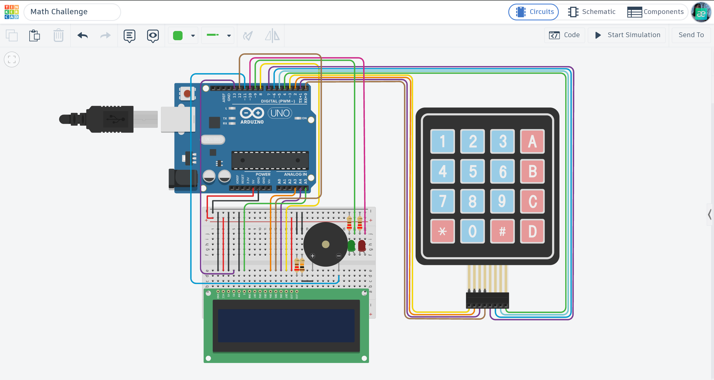

# 🧠 Arduino Math Challenge: Interactive Math Game

An interactive mathematical quiz game designed to test calculation skills using Arduino Uno R3, featuring a 4x4 matrix keypad, 16x2 LCD display, three difficulty levels, a countdown timer, and audio-visual feedback.

## 📌 Project Overview

This project transforms an Arduino Uno into an interactive math challenge game. Players solve randomly generated arithmetic problems using a 4x4 matrix keypad.

The system supports three difficulty levels: Easy, Normal, and Hard. Each mode provides a different challenge, with Normal and Hard modes introducing a countdown timer.

A 16x2 LCD displays mathematical expressions, user input, current score, and remaining time. Green and red LEDs indicate the result of each answer, while a piezo buzzer provides audio feedback.

## ⚙️ How it Works (System Logic)

The game operates through a sequence of difficulty selection, question generation, answer validation, and score tracking:

* **Game Initialization:**
   * LCD displays the welcome message "Epic Math Game".
   * The player is prompted to select a difficulty level.

* **Difficulty Selection:**
   * Easy Mode — No time limit.
   * Normal Mode — 20 seconds per question.
   * Hard Mode — 10 seconds per question.

* **Question Generation:**
   * Pressing the A button generates a random mathematical expression.
   * Supported operations include addition, subtraction, multiplication, and division.

* **Answer Input:**
   * The player enters a numerical answer using the 4x4 keypad.
   * The `-` key acts as a backspace when input has already started.
   * The `.` key allows decimal input.

* **Answer Validation:**
   * Pressing B submits the answer.
   * The entered value is compared with the calculated result.

* **Correct Answer:**
   * Green LED turns ON.
   * The buzzer plays an ascending sound sequence.
   * The score increases by one point.

* **Incorrect Answer:**
   * Red LED turns ON.
   * The buzzer plays a descending sound sequence.
   * The score remains unchanged.

* **Timer System:**
   * Normal Mode provides 20 seconds to solve each question.
   * Hard Mode provides 10 seconds.
   * Easy Mode operates without a countdown timer.

* **Statistics:**
   * Pressing C displays the total number of questions and correct answers.

* **Game Reset:**
   * Pressing D restarts the game.
   * The score and question counter are reset.
   * The difficulty selection screen appears again.

## 🛠 Technical Highlights

- **Matrix Keypad Scanning:** Uses the `Keypad.h` library to detect input from a 4x4 matrix keypad.
- **LCD Interface:** Uses the `LiquidCrystal.h` library to display questions, answers, scores, and timer information.
- **Random Question Generation:** Uses `random()` to generate operands and select arithmetic operations.
- **Multiple Difficulty Levels:** Implements three modes with different time constraints.
- **Answer Validation:** Processes numerical input and compares it with the calculated answer.
- **Division Logic:** Adjusts operands to generate division questions with manageable results.
- **Countdown Timer:** Uses `millis()` to calculate the remaining time.
- **Audio Feedback:** Uses `tone()` to generate ascending and descending sound sequences.
- **Visual Indicators:** Green and red LEDs provide immediate feedback.
- **Score Tracking:** Maintains the total number of questions and correctly answered questions.

## 🔌 Components Used

- **Microcontroller:** Arduino Uno R3
- **Input:** 4x4 Matrix Keypad
- **Display:** 16x2 LCD Display
- **Audio Output:** Piezo Buzzer
- **Indicators:** Green LED and Red LED
- **Others:** 220Ω Resistors, Breadboard, and Jumper Wires.

## 📐 Circuit Diagram

*Designed and simulated in Tinkercad.*

## 🚀 Installation & Use

1. Open the [main.ino](./main.ino) file in this folder.
2. Copy the code to your Arduino IDE or Tinkercad environment.
3. Ensure the `LiquidCrystal` and `Keypad` libraries are included in your project.
4. Connect the LCD, 4x4 Matrix Keypad, buzzer, LEDs, and resistors according to the circuit diagram.
5. Start the simulation or upload the code to the Arduino Uno.
6. Select the desired difficulty level using the keypad.
7. Press A to generate a mathematical question.
8. Enter your answer and press B to submit it.
9. Press C to view your current statistics.
10. Press D to restart the game.

## 📺 Video Demonstration

Watch the system in action (click the image below):

## 🔗 Interactive Simulation

